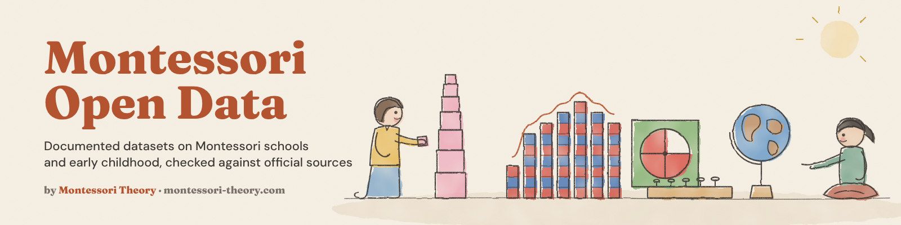

# Montessori Open Data

**Free, documented datasets on Montessori schools, early childhood, school choice and homeschooling, checked against their official sources.**

Every dataset has its own repository with a cover, a data dictionary, a method, its known limits and a citation. The same data is on Kaggle, with a starter notebook, and on Hugging Face, ready for the `datasets` library. They come from the research behind [Montessori Theory](https://www.montessori-theory.com/), a site about Montessori at home.

## 🏫 Montessori Schools

| Dataset | GitHub | Kaggle | Hugging Face | DOI |
|---|---|---|---|---|
| 2,070 Montessori private schools in 2023-24, and 37,543 school-year records from 18 NCES survey waves since 1989, by state, city and county | [us-montessori-private-schools](https://github.com/montessoritheory/us-montessori-private-schools) | [Kaggle](https://www.kaggle.com/datasets/mariamontessori/us-montessori-private-schools) | [Dataset](https://huggingface.co/datasets/montessoritheory/us-montessori-private-schools) | [Zenodo](https://doi.org/10.5281/zenodo.23871758) |

A research note built on this dataset, *How Many Montessori Private Schools Are There in the United States?*, is archived at [doi.org/10.5281/zenodo.23871815](https://doi.org/10.5281/zenodo.23871815).

## 👶 Early Childhood And Pre-K

| Dataset | GitHub | Kaggle | Hugging Face |
|---|---|---|---|
| Who looks after US children aged 0 to 5, for how many hours, at what weekly cost, and what parents look for. 12,936 children from the NCES NHES Early Childhood Program Participation survey, 2016 and 2019 | [us-early-childhood-care](https://github.com/montessoritheory/us-early-childhood-care) | [Kaggle](https://www.kaggle.com/datasets/mariamontessori/us-early-childhood-care) | [Dataset](https://huggingface.co/datasets/montessoritheory/us-early-childhood-care) |
| Public pre-K, kindergarten and every grade by state, every fall from 2010 to 2022 (NCES Common Core of Data), plus the share of 3- to 5-year-olds in school by state, 2021 to 2023 | [us-public-prek-kindergarten](https://github.com/montessoritheory/us-public-prek-kindergarten) | [Kaggle](https://www.kaggle.com/datasets/mariamontessori/us-public-prek-kindergarten) | [Dataset](https://huggingface.co/datasets/montessoritheory/us-public-prek-kindergarten) |

## 🏡 School Choice And Homeschooling

| Dataset | GitHub | Kaggle | Hugging Face |
|---|---|---|---|
| Public, charter, private or homeschool, why parents choose a school, why they homeschool and how satisfied they are. 30,521 students from the NCES NHES Parent and Family Involvement in Education survey, 2016 and 2019 | [us-school-choice-homeschooling](https://github.com/montessoritheory/us-school-choice-homeschooling) | [Kaggle](https://www.kaggle.com/datasets/mariamontessori/us-school-choice-homeschooling) | [Dataset](https://huggingface.co/datasets/montessoritheory/us-school-choice-homeschooling) |

More datasets on child development and early education will be added here as they are released.

## How The Data Is Checked

Each dataset is rebuilt from its official source, then compared with the figures the source publishes.

- **US Montessori private schools.** The weighted estimate matches the NCES figure of 2,441 Montessori schools for 2021-22, and the total of all private schools matches the NCES national totals for every wave from 1997-98 to 2015-16.
- **Early childhood care.** The share of children with weekly nonparental care in 2019, 59 %, matches the NCES published figure.
- **School choice and homeschooling.** The 2016 homeschooling estimate, 1.69 million students or 3.3 %, matches NCES Digest table 206.10 exactly, and the reasons for homeschooling in 2019 are within one point of Digest table 206.15.
- **Public pre-K and kindergarten.** For every fall from 2010 to 2022, the 50 states and DC add up exactly to the published US total.

Survey files come with the 80 NCES jackknife replicate weights, so standard errors can be computed. The checks are listed in each README under Checked Against The Source.

## Quick Start

```python
import pandas as pd

base = "https://raw.githubusercontent.com/montessoritheory"
schools = pd.read_csv(f"{base}/us-montessori-private-schools/main/data/montessori_private_schools_2023_24.csv")
schools.groupby("state").size().sort_values(ascending=False).head(10)

prek = pd.read_csv(f"{base}/us-public-prek-kindergarten/main/data/prek_and_kindergarten_by_state.csv")
prek[prek.fall_year == 2022].sort_values("prek_per_100_kindergartners", ascending=False).head(10)
```

## License

All datasets are CC BY 4.0. Each repository has its own LICENSE and CITATION.cff. Please credit Montessori Theory, with a link to [montessori-theory.com](https://www.montessori-theory.com/), and the original source when you reuse them.

## Version Française

**Des jeux de données ouverts et documentés sur les écoles Montessori et la petite enfance, vérifiés à la source.** Chaque jeu existe sur GitHub, Kaggle et Hugging Face, sous licence CC BY 4.0, avec un dictionnaire des colonnes, la méthode et les limites. On y trouve les 2 070 écoles Montessori privées des États-Unis en 2023-24, la garde des enfants de 0 à 5 ans (2016 et 2019), le choix de l'école et l'instruction en famille (2016 et 2019), et les effectifs de pre-K et de maternelle publiques par État de 2010 à 2022, d'après les enquêtes officielles NCES.
